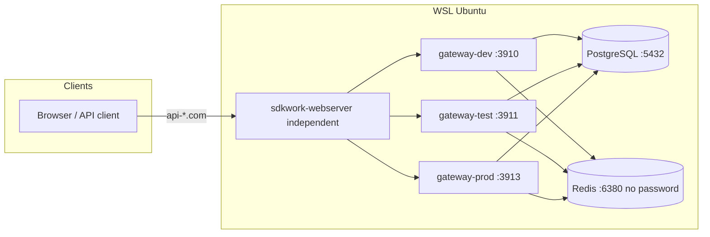

# WSL Ubuntu 多环境 Docker 部署（外连 PostgreSQL / Redis）

本指南描述在 **WSL Ubuntu** 上同时运行 development、test、production
（及可选 staging）网关容器，使用 **外部** PostgreSQL 与 **无密码** Redis。

公网反向代理由独立产品 **sdkwork-webserver** 配置；本网关 **不安装 nginx 站点映射**。

容器与 Ubuntu 安装使用同一配置根（`topology.applicationCode = api-gateway`）：

| Purpose | Path |
| --- | --- |
| Config | `/etc/sdkwork/api-gateway/config.toml` |
| Secrets (container) | `/run/secrets/sdkwork/api-gateway` |
| Secrets (host) | `/etc/sdkwork/api-gateway/secrets/` |
| Data | `/var/lib/sdkwork/api-gateway` |
| Install | `/opt/sdkwork/api-gateway` |

## 架构概览



| 环境 | Compose 项目名 | 宿主端口 → 容器 3900 | 数据库 |
| --- | --- | --- | --- |
| development | `sdkwork-gateway-development` | **3910** | `sdkwork_ai_dev` |
| test | `sdkwork-gateway-test` | **3911** | `sdkwork_ai_test` |
| staging | `sdkwork-gateway-staging` | **3912** | `sdkwork_ai_staging` |
| production | `sdkwork-gateway-production` | **3913** | `sdkwork_ai_prod` |

端口矩阵：[`deployments/README.md`](../../deployments/README.md)。

## 1. 宿主机依赖

```bash
sudo bash scripts/deploy/prepare-host.sh
# 或手动安装 postgresql + pgvector + redis-server（6380，无密码）
```

## 2. 按环境初始化数据库

```bash
cd /mnt/e/sdkwork-space/sdkwork-api-cloud-gateway

export SDKWORK_DATABASE_ADMIN_HOST=127.0.0.1
export SDKWORK_DATABASE_ADMIN_PORT=5432
export SDKWORK_DATABASE_ADMIN_USERNAME=postgres
export SDKWORK_DATABASE_ADMIN_PASSWORD=<postgres-admin-password>

scripts/provision-external-databases.sh
```

## 3. 配置环境变量

```bash
cp docker/env/development.env.example docker/env/development.env
cp docker/env/test.env.example docker/env/test.env
cp docker/env/production.env.example docker/env/production.env
# 填写 GATEWAY_POSTGRES_PASSWORD；Redis 保持 GATEWAY_CLOUDROUTER_REDIS_PASSWORD=
```

## 4. 构建并部署（默认外部依赖，无 nginx）

```bash
pnpm build:container
pnpm deploy:apply -- --env development test production
# 或: scripts/deploy-docker-environment.sh all --validate
```

Compose 默认只启动 `knowledgebase-rpc` + `gateway`；内置 postgres/redis 需
`--profile embedded`。

## 5. 健康检查

```bash
curl -fsS http://127.0.0.1:3910/healthz
curl -fsS http://127.0.0.1:3911/healthz
curl -fsS http://127.0.0.1:3913/healthz
```

域名访问在 **sdkwork-webserver** 中把上游指到上述端口后验证。

## 6. 布局校验

```bash
node ../sdkwork-specs/tools/check-application-deploy-layout.mjs --root .
# ok  sdkwork-api-cloud-gateway (api-gateway) -> /etc/sdkwork/api-gateway/config.toml
```
