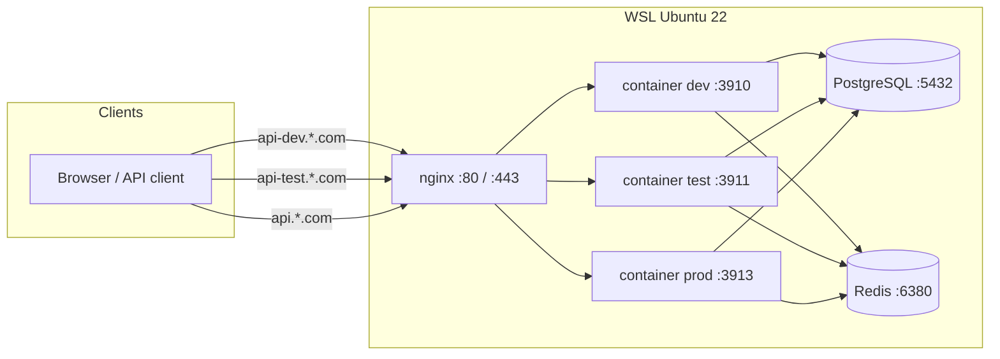

# WSL Ubuntu 22 多环境 Docker 部署（外连 PostgreSQL / Redis）

本指南描述在 **WSL Ubuntu 22.04** 上同时运行 development、test、production
三套（及可选 staging）网关容器，通过 **nginx 80 端口**对外提供域名访问，
并使用 **外部部署** 的 PostgreSQL 与 Redis（Ubuntu 宿主机 apt 安装或远端托管）。

## 架构概览



| 环境 | Compose 项目名 | 宿主端口 → 容器 3900 | 数据库（sdkwork-specs） | 域名（三品牌） |
| --- | --- | --- | --- | --- |
| development | `sdkwork-gateway-development` | **3910** | `sdkwork_ai_dev` | `api-dev.{sdkwork,birdcoder,dtupay}.com` |
| test | `sdkwork-gateway-test` | **3911** | `sdkwork_ai_test` | `api-test.{sdkwork,birdcoder,dtupay}.com` |
| staging | `sdkwork-gateway-staging` | **3912** | `sdkwork_ai_staging` | `api-staging.{sdkwork,birdcoder,dtupay}.com` |
| production | `sdkwork-gateway-production` | **3913** | `sdkwork_ai_prod` | `api.{sdkwork,birdcoder,dtupay}.com` |

端口矩阵详见 [`deployments/README.md`](../../deployments/README.md)。

## 1. 宿主机依赖（Ubuntu 22.04）

### PostgreSQL + pgvector

```bash
sudo apt update
sudo apt install -y postgresql postgresql-contrib
# 安装与服务器大版本匹配的 pgvector（示例 PG14）：
sudo apt install -y postgresql-14-pgvector
```

`postgresql.conf` 需允许 Docker 网桥访问：

```ini
listen_addresses = '*'
```

`pg_hba.conf` 追加（docker 默认网段）：

```
host    all    all    172.16.0.0/12    scram-sha-256
```

### Redis

```bash
sudo apt install -y redis-server
```

`/etc/redis/redis.conf`：

```ini
port 6380
bind 0.0.0.0
# 内网免密可设 protected-mode no；生产请启用 ACL/密码
```

```bash
sudo systemctl restart postgresql redis-server
```

## 2. 按环境初始化数据库

遵循 `sdkwork-specs` ENVIRONMENT_SPEC §7.1：库名 = schema 名 = 用户名。

```bash
cd /mnt/e/sdkwork-space/sdkwork-api-cloud-gateway   # 或你的仓库路径

export SDKWORK_DATABASE_ADMIN_HOST=127.0.0.1
export SDKWORK_DATABASE_ADMIN_PORT=5432
export SDKWORK_DATABASE_ADMIN_USERNAME=postgres
export SDKWORK_DATABASE_ADMIN_PASSWORD=<postgres-admin-password>

# 为 dev / test / staging / prod 四套库建库、schema、vector 扩展、业务角色
chmod +x scripts/provision-external-databases.sh
scripts/provision-external-databases.sh
```

也可单独初始化某一环境：

```bash
scripts/provision-external-databases.sh development test
```

## 3. 配置环境变量

受控模板：`docker/env/<environment>.env.example`  
部署副本（不入库）：`docker/env/<environment>.env`

```bash
cp docker/env/development.env.example docker/env/development.env
cp docker/env/test.env.example docker/env/test.env
cp docker/env/production.env.example docker/env/production.env
# 编辑各文件，替换 <CHANGE_ME> 密码与 CloudRouter 生产密钥
```

外连模式关键项（已在模板中）：

| 变量 | 说明 |
| --- | --- |
| `GATEWAY_POSTGRES_HOST` | `host.docker.internal`（WSL 宿主 PG） |
| `GATEWAY_POSTGRES_DB/SCHEMA/USER` | 按环境：`sdkwork_ai_dev` / `_test` / `_prod` |
| `GATEWAY_CLOUDROUTER_REDIS_HOST` | `host.docker.internal` |
| `GATEWAY_CLOUDROUTER_REDIS_PORT` | `6380` |
| `GATEWAY_CLOUDROUTER_REDIS_KEY_PREFIX` | 按环境隔离键前缀 |
| `GATEWAY_CORS_ALLOWED_ORIGINS` | 浏览器与桌面端 Origin 白名单；开发环境需包含 `app://dsh` 等桌面 shell scheme |
| `GATEWAY_RTC_STATE_REDIS_URL` | 共享 Redis 时使用不同 logical DB（dev 1/2, test 3/4, prod 7/8） |
| `GATEWAY_WEB_REDIS_URL` | 同上 |

## 4. 构建镜像并部署

```bash
pnpm build:container

# 预检（矩阵校验域名、库名、外连必填项）
pnpm check:container-deployment

# 启动单环境或全部环境（外连模式）
pnpm deploy:apply:standalone -- development --validate
pnpm deploy:apply:standalone -- all --validate
```

等价手动命令：

```bash
docker compose --env-file docker/env/development.env \
  -p sdkwork-gateway-development \
  -f docker-compose.yml -f docker-compose.external.yml up -d
```

## 5. 配置 nginx（80 端口对外）

```bash
sudo apt install -y nginx
sudo pnpm nginx:install -- all
```

各站点将 `server_name` 三品牌别名代理到对应宿主端口：

| nginx 配置 | 代理目标 |
| --- | --- |
| `docker/nginx/api-dev.sdkwork.com.conf` | `127.0.0.1:3910` |
| `docker/nginx/api-test.sdkwork.com.conf` | `127.0.0.1:3911` |
| `docker/nginx/api-staging.sdkwork.com.conf` | `127.0.0.1:3912` |
| `docker/nginx/api.sdkwork.com.conf` | `127.0.0.1:3913`（443 TLS + 80 重定向） |

## 6. 域名解析

**本地 WSL 开发**：Windows `hosts` 与 WSL `/etc/hosts` 追加：

```
127.0.0.1 api-dev.sdkwork.com api-dev.birdcoder.com api-dev.dtupay.com
127.0.0.1 api-test.sdkwork.com api-test.birdcoder.com api-test.dtupay.com
127.0.0.1 api.sdkwork.com api.birdcoder.com api.dtupay.com
```

**正式上线**：DNS A/AAAA 记录指向服务器公网 IP；生产 TLS 证书放入
`/etc/ssl/sdkwork/api-gateway/`（见 `docker/nginx/api.sdkwork.com.conf`）。

## 7. 验证

```bash
curl -fsS http://127.0.0.1:3910/healthz    # development
curl -fsS http://127.0.0.1:3911/readyz     # test
curl -fsS http://api-dev.sdkwork.com/healthz
curl -fsS http://api-dev.birdcoder.com/readyz
curl -fsS http://api-test.dtupay.com/healthz
curl -fsS https://api.sdkwork.com/healthz  # production（需 TLS）
```

Host 白名单隔离：用错误 Host 访问应返回 421：

```bash
curl -H "Host: api-test.sdkwork.com" http://127.0.0.1:3910/healthz   # 421
```

## 8. 打包分发

```bash
scripts/package-docker-environments.sh
# 输出 dist/docker-packages/{development,test,staging,production}/
```

每个 bundle 含 compose 文件、环境 `.env`、nginx 站点与 README。

## 相关文档

- [DOCKER_STANDALONE_QUICK_DEPLOY.md](DOCKER_STANDALONE_QUICK_DEPLOY.md) — 镜像构建与单机快速启动
- [DATABASE_INITIALIZATION.md](DATABASE_INITIALIZATION.md) — 迁移与 `db:init`
- [`deployments/README.md`](../../deployments/README.md) — 完整端口矩阵
